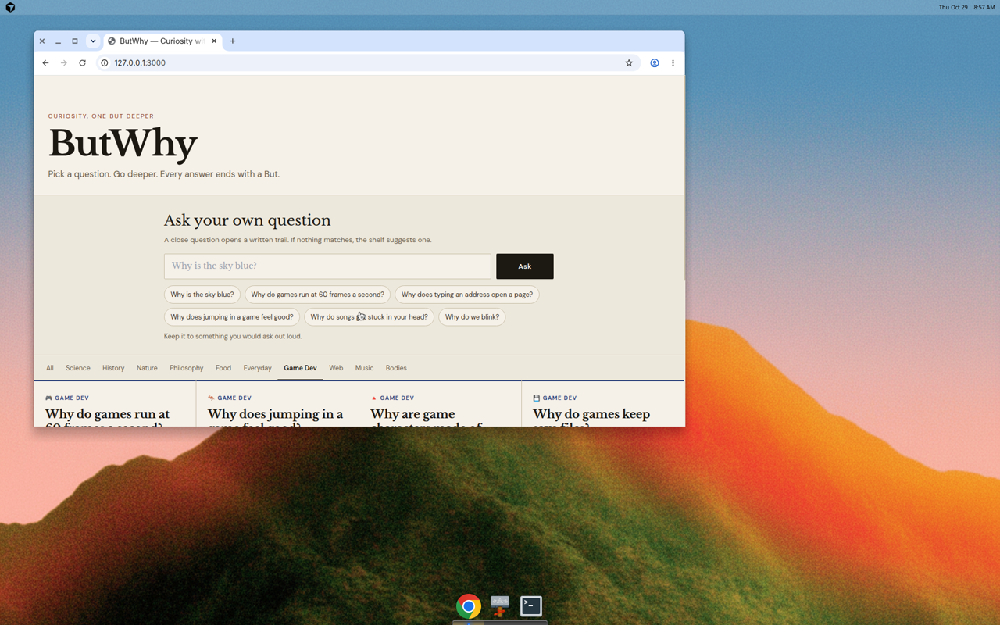
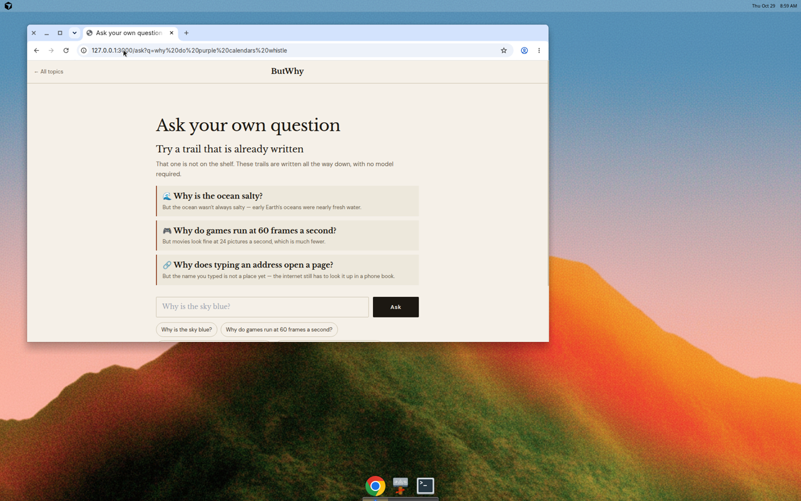
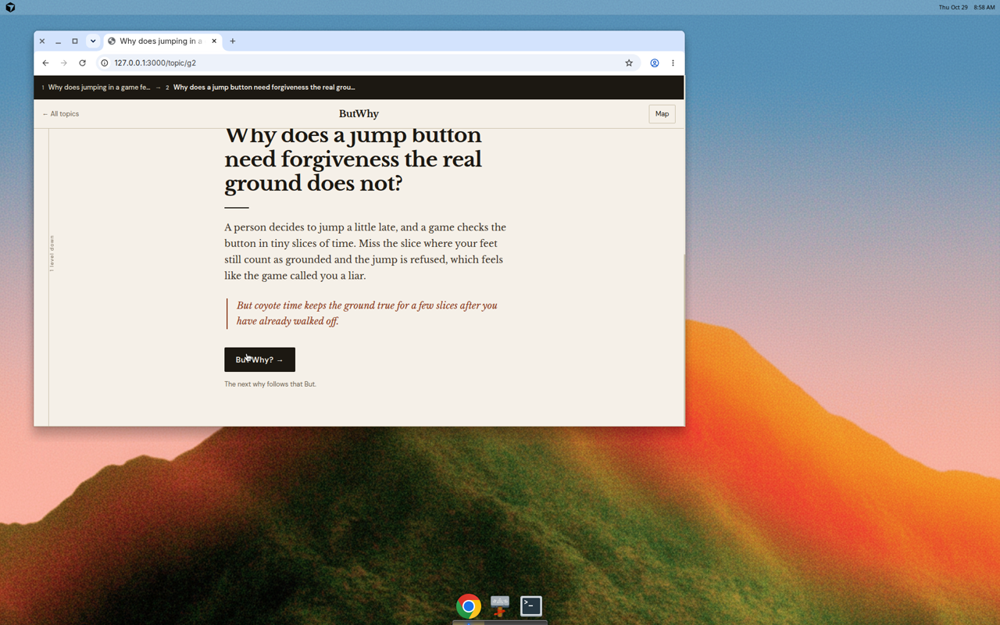
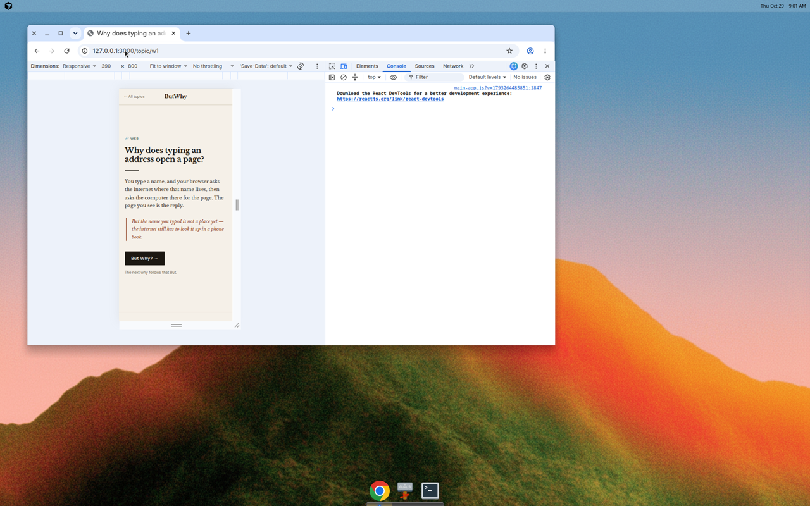
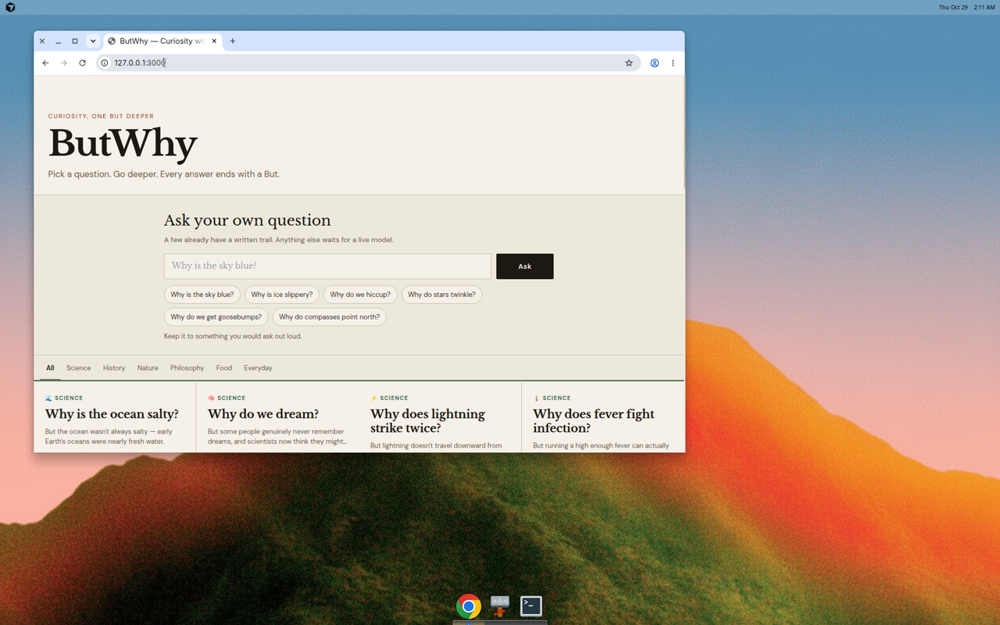
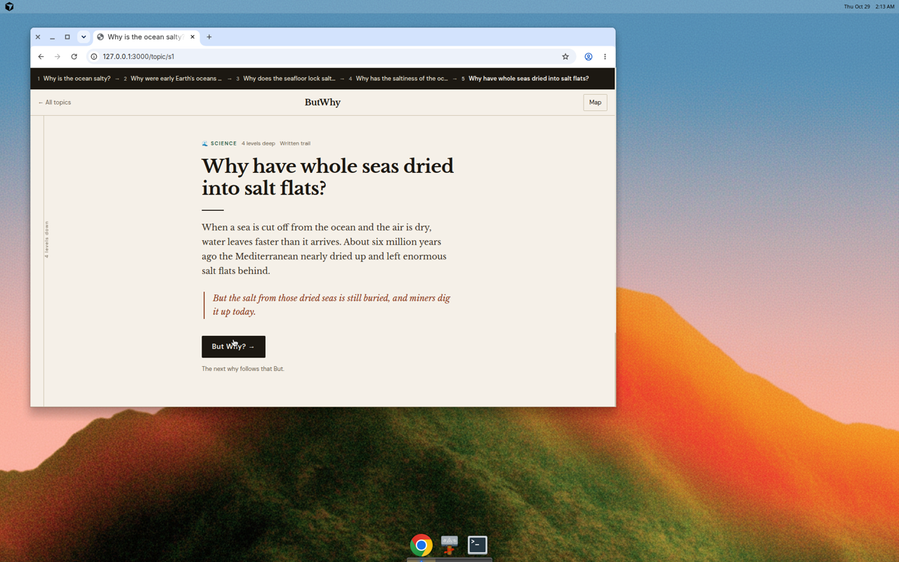
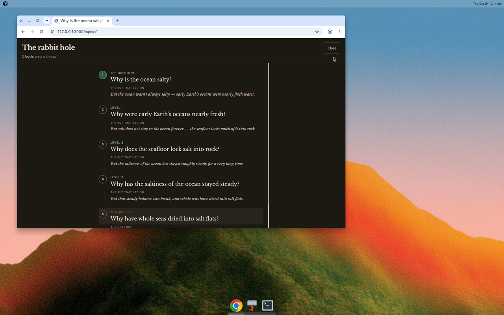
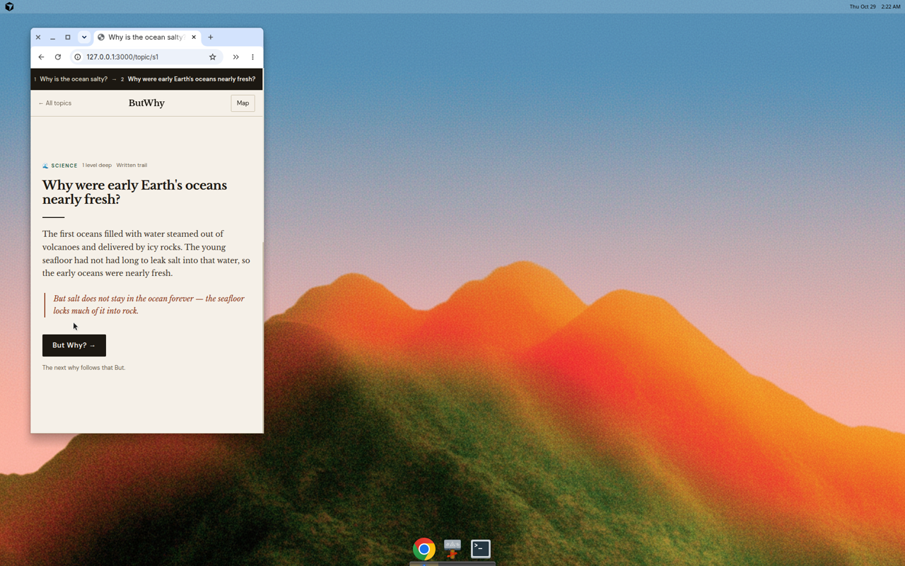

# ButWhy

Ask why. The answer ends with a But. Ask why again.

[butwhy-droo4you.vercel.app](https://butwhy-droo4you.vercel.app)

ButWhy is a small curiosity engine: a shelf of questions, and a hole under each one. It was built on a lunch break, after a "but why?" loop with a second grader. The second grader did not accept the first answer, or the second. The page is that loop, with a place to stop telling stories when the trail runs out.

The old deploy answered every tap after the first with the same card, "Why does curiosity have no bottom?". That was a hardcoded fallback for a missing model key. The shelf is now the whole product: each trail is written about eight whys down, to a bedrock card, and a model is off unless you opt in.

## The loop

Each card is a question, a short answer, and one sentence that starts with But. The next card is the why inside that But. It is not a new topic picked at random, and it is not a repeat of a question already on the trail.

By default (`LLM_PROVIDER` unset or `off`):

- Every question on the shelf, including Game Dev, Web, Music, and Bodies, has about eight written follow-ups. The last card is bedrock.
- Typing a close question opens that trail. "60 fps", "type a url", "coyote time", "polygons", "save files" all land on written holes.
- A question that is only nearby gets a few suggested trails. A question that matches nothing still gets a handful of shelves to start from. No model is required, and none is called.
- One more tap after bedrock says you hit bedrock. Nothing is invented.

A live model is optional and off. Set `LLM_PROVIDER=auto` (and a key) only if you want paid follow-ups past the written bottom. Those replies are cached. `LLM_PROVIDER=mock` is a local stand-in whose cards say "Practice answer" in the text. Production on Vercel ignores mock.

## Screenshots

Home, with Game Dev on the shelf and a place to ask:



A typed question that is not on the shelf gets nearby trails, not a model bill:



Jumping, one why down, already on coyote time:



Typing an address, on a phone-width screen:



Home, with a place to ask:



Four taps down from "Why is the ocean salty?", still on the written trail (four more whys remain under this card, then bedrock):



The map is the hole, with each But as the thread to the next question:



A phone-width trail. The breadcrumb scrolls; the card does not grow a side ruler over the words:



Before this revamp, taps 1 through 7 on the ocean question all showed "Why does curiosity have no bottom?" The live API returned that object with `_provider: "fallback"`. The breadcrumb repeated it too.

## Run it

Node 20 or newer.

```bash
npm install
cp .env.local.example .env.local
npm run dev
```

Open http://localhost:3000.

```bash
npm run lint
npm run build
npm run verify
```

`verify` checks every written trail: the next question shares a real word with the previous But, topics do not repeat, and a 7-step mock loop stays distinct and connected. It does not call a paid API.

To exercise the generator without a key:

```bash
LLM_PROVIDER=mock npm run dev
```

Practice cards are labeled in the answer itself. Do not set `LLM_PROVIDER=mock` on Vercel. If `VERCEL_ENV=production`, mock is ignored and the trail pauses instead.

## What droober sets on Vercel

Project: the one serving https://butwhy-droo4you.vercel.app. Set these under Settings → Environment Variables for **Production** and **Preview**, then redeploy. None of the keys use a `NEXT_PUBLIC_` prefix.

| Name | Required | What to put |
| --- | --- | --- |
| `LLM_PROVIDER` | no | Leave unset, or set `off`. The shelf does not need a model. Set `auto` only to opt into paid taps past bedrock. |
| `GROQ_API_KEY` | only if you opted into a live model | From [console.groq.com](https://console.groq.com). Cheapest if you turn live mode on. |
| `GROQ_MODEL` | no | `llama-3.1-8b-instant`. If the plan does not list it, `openai/gpt-oss-20b`. |
| `GEMINI_API_KEY` | no | Only if Groq is not the key you have. [aistudio.google.com](https://aistudio.google.com) |
| `GEMINI_MODEL` | no | `gemini-2.5-flash-lite` |
| `OPENAI_API_KEY` | no | Optional third provider. |
| `OPENAI_MODEL` | no | `gpt-4o-mini` |
| `ANTHROPIC_API_KEY` | no | Optional. Pricier. Not used by `auto` unless it is the only key. |
| `ANTHROPIC_MODEL` | no | `claude-haiku-4-5-20251001` |
| `LLM_MODEL` | no | Overrides the model only when `LLM_PROVIDER` names one provider. Leave unset for `auto`. |
| `LLM_CALL_BUDGET` | no | `200`. Live calls per server instance. Written trails do not count. |
| `NEXT_PUBLIC_SITE_URL` | no | `https://butwhy-droo4you.vercel.app` |

Leave `LLM_PROVIDER` off and you can leave every key blank. Cost per tap on the shelf is zero.

If you do set `auto`, it tries Groq, then Gemini Flash-Lite, then OpenAI, then Claude, and stops at the first key it finds. Naming a provider (`LLM_PROVIDER=groq`) uses that provider only.

You do not need Supabase. `NEXT_PUBLIC_SUPABASE_URL` and `NEXT_PUBLIC_SUPABASE_ANON_KEY` are unused. Shareable saved trails were never wired; `/chain/some-id` says so.

A rough cost for one new live card, only after you opt in, at list prices in October 2026: under a hundredth of a cent on Groq's 8B instant model. The written trails, which are the default, cost nothing.

Also point the GitHub About website at https://butwhy-droo4you.vercel.app. It still advertises https://butwhy-pi.vercel.app, which 404s.

## Ask box

The field on the home page accepts a short question. A close match opens a written trail, including shorthand like "60 fps" or "type a url". If nothing is close enough to open, the page suggests a few trails instead of calling a model. The server rejects an empty or huge string, a few obvious harm requests, and anything that pairs a child with sexual content. A live model, if you turn one on, is still prompted for an eight-year-old reading with an adult, and a reply that fails that check is not shown.

## Layout

Cream paper, Libre Baskerville, DM Sans. The chain is one card per viewport. The dark bar is the trail so far; Map is the same trail drawn as a hole, with the But sitting between the questions.
